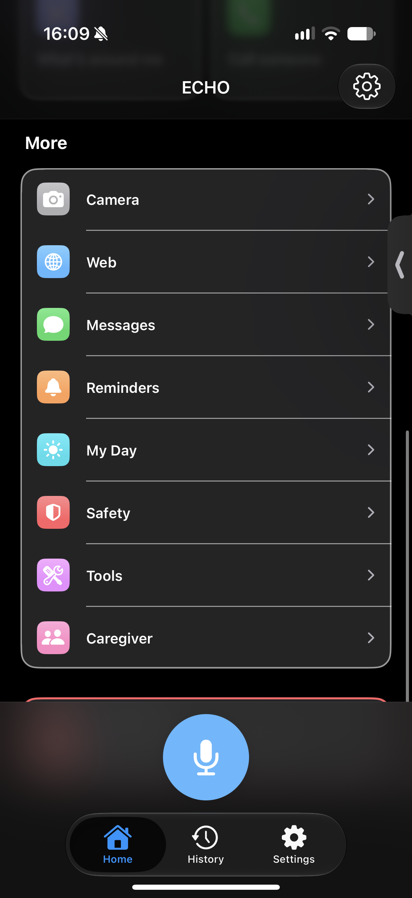
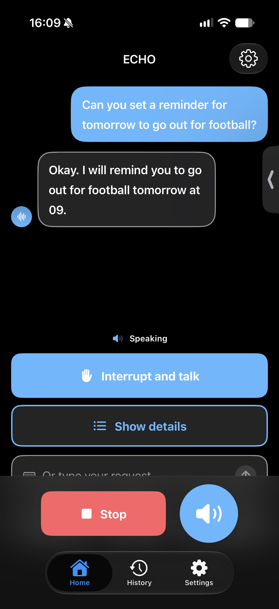
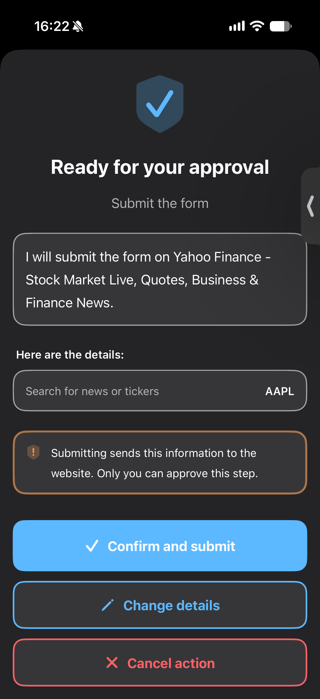
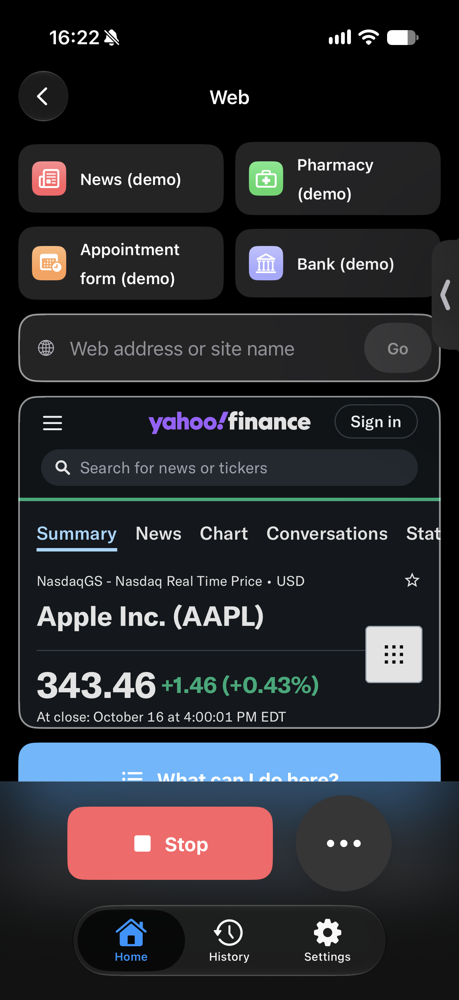

# ECHO

**Independence, out loud.** ECHO is a voice-first iOS assistant for blind, low-vision and elderly people. You talk, it listens, and it answers out loud, and it can act for you: look through the camera, read labels and letters, use websites, send messages, set reminders, and call for help.

Before anything with consequences (a call, a message, a form submission) ECHO shows and speaks exactly what it will do and waits for your yes.

## Screenshots

  
  
  
  

More screens are in the [screenshots](screenshots) folder.

## Features

- **Conversation:** hands-free, streamed answers spoken sentence by sentence. Interrupt by tapping, saying stop, or shaking the phone.
- **Live AI:** Claude, with live web search, tool use and photo understanding. A built-in demo mode works with no key.
- **Camera:** describe a scene, read text, scan a document, identify a color, find an object. Text reading runs on the device.
- **Web:** open a site, hear what you can do there, press buttons and fill fields by voice, and have the page read aloud.
- **Messages:** dictate texts and emails, have them read back and polished, and hear your inbox one message at a time.
- **Daily life:** reminders by voice, a morning briefing, and "where am I".
- **Safety:** an emergency button and a call to emergency services, both confirmed first, plus a caregiver dashboard (demo data).
- **Accessibility:** works with VoiceOver, Voice Control, Switch Control and Dynamic Type. It uses VoiceOver's own voice when VoiceOver is on. A voice-only mode shows one calm screen, and simple mode shows four big buttons.

## Requirements

- iOS 17 or later, Xcode 26 or later.
- Apple frameworks only; there are no third-party dependencies.
- An Anthropic API key is optional. Without one, ECHO uses the demo mode.

## Run it

1. Open `diffAI.xcodeproj`, select the `diffAI` target, and choose your team under Signing & Capabilities.
2. Run it on an iPhone. The Simulator works too, but it has no camera and its speech recognition is unreliable.
3. For live AI, open Settings, paste your API key, and turn on **Use live AI**. The key is stored in the device Keychain only.

## Notes

- iOS requires you to tap Send yourself for texts and emails; ECHO prepares them and opens the system sheet.
- Contacts, inbox, caregiver data and weather are clearly fake demo data.
- Design decisions and known limits are in [ASSUMPTIONS.md](ASSUMPTIONS.md).
